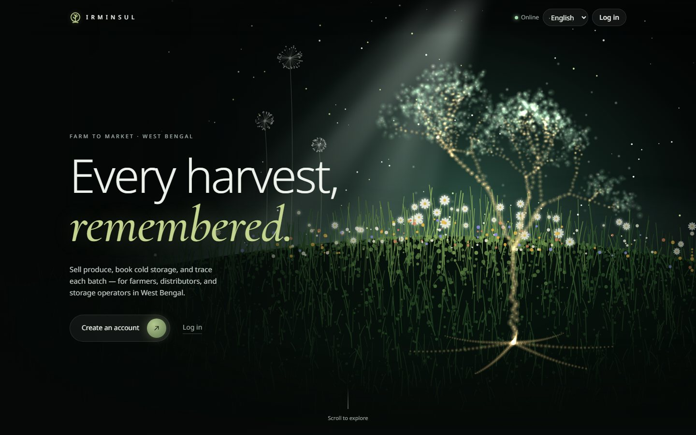
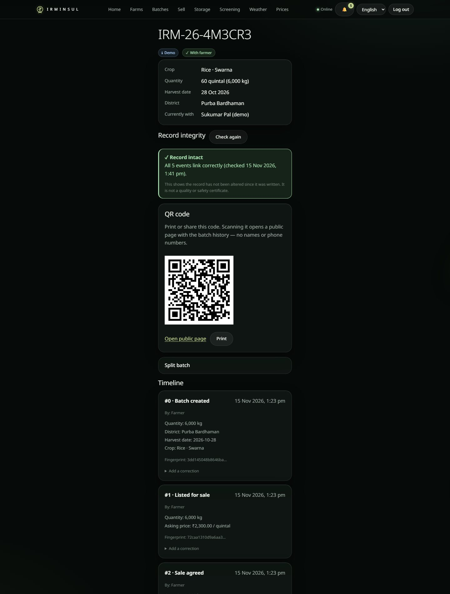
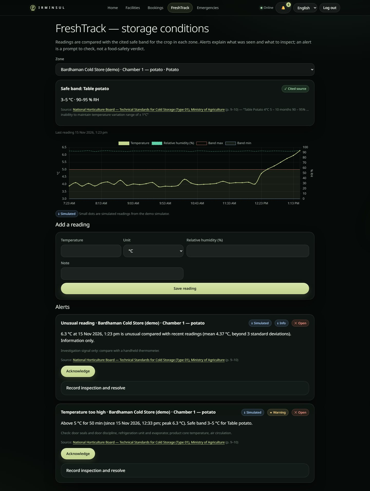
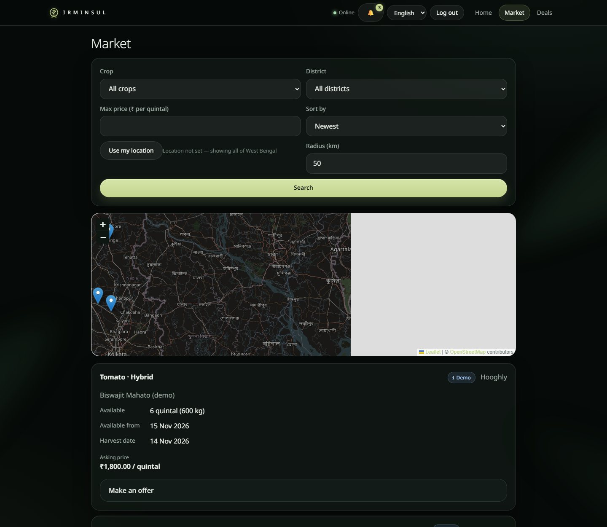
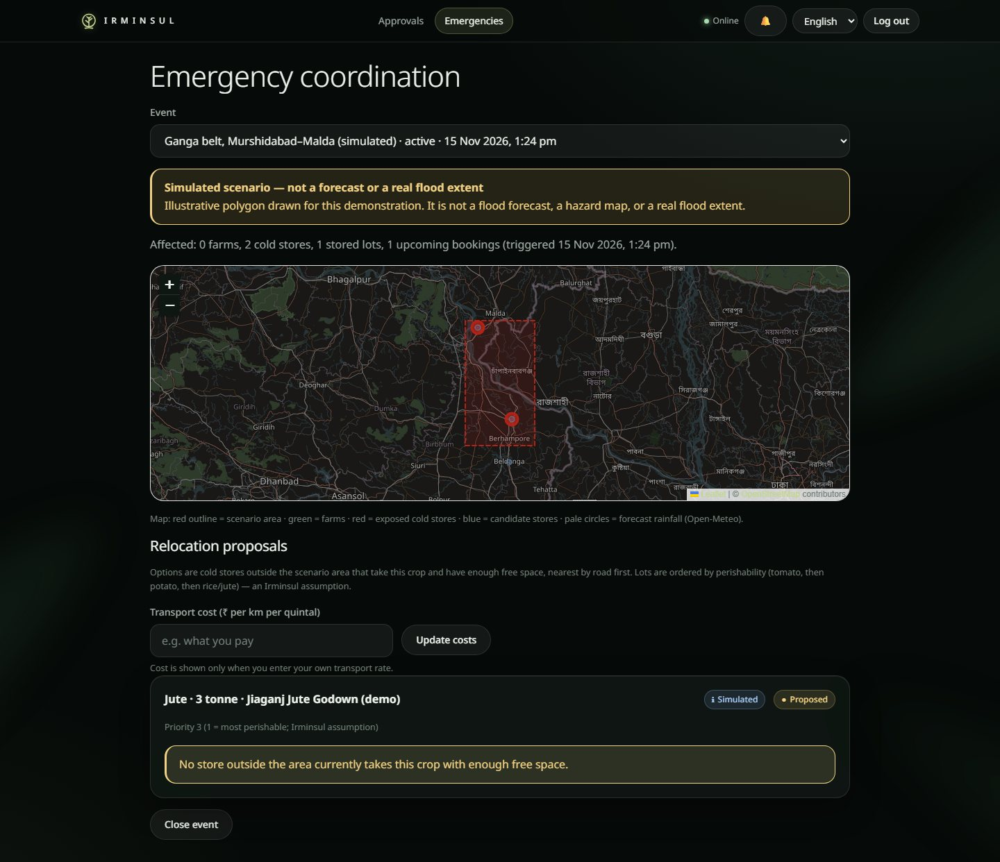
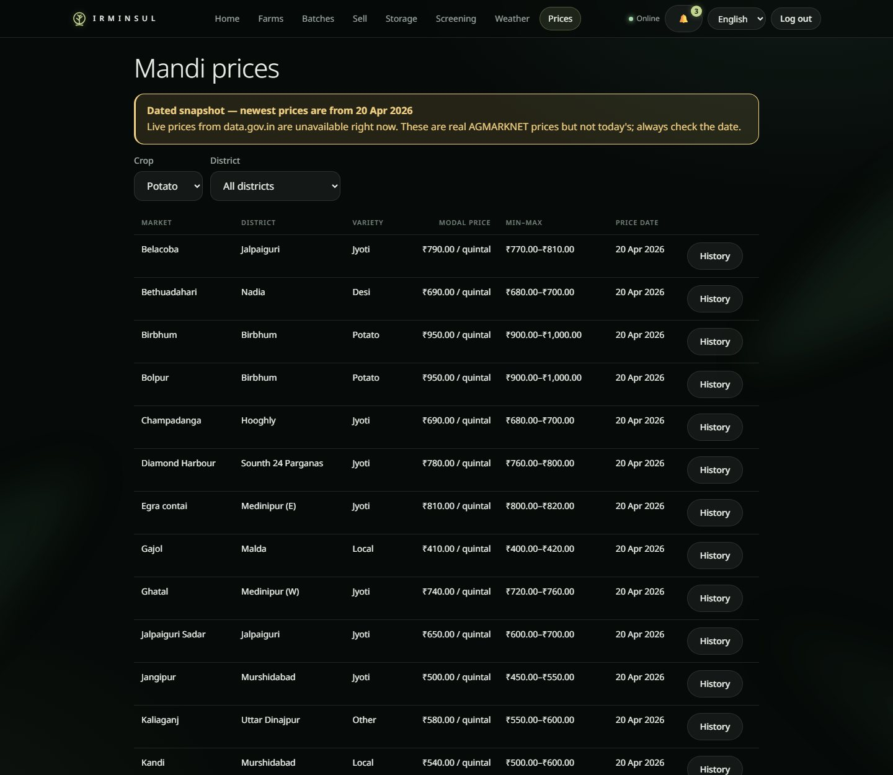
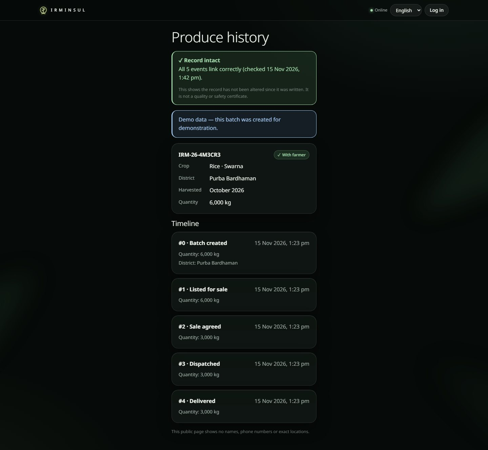
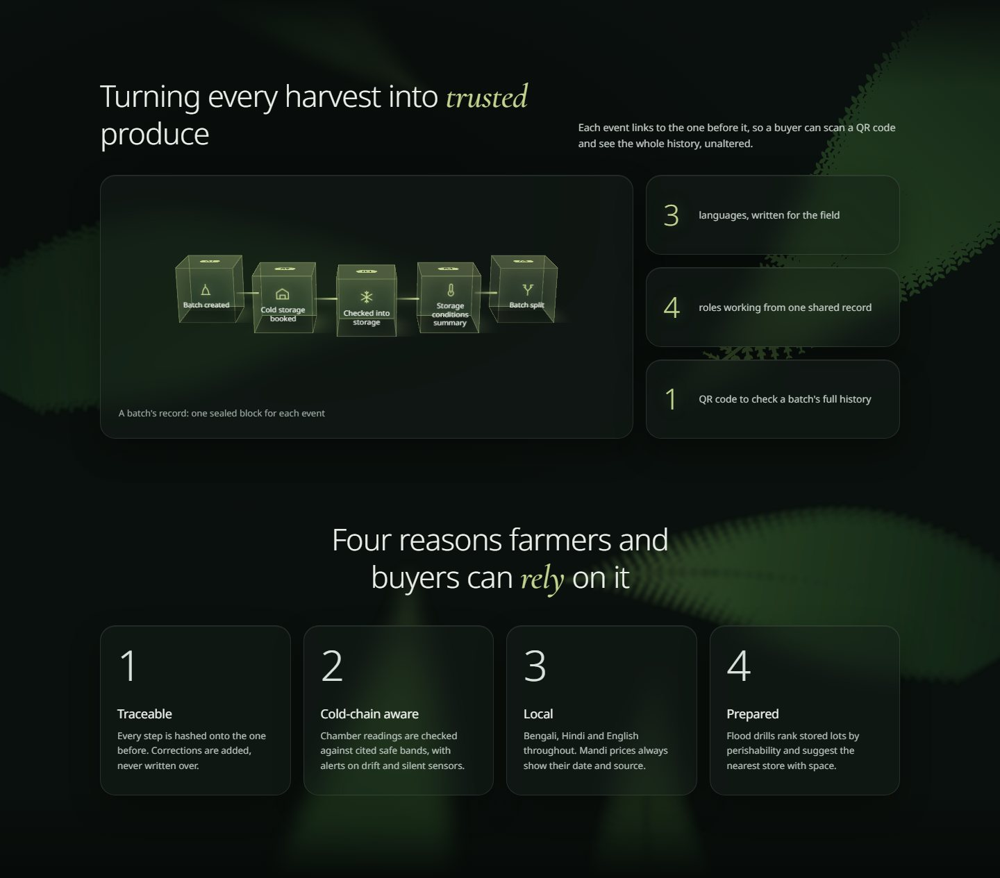
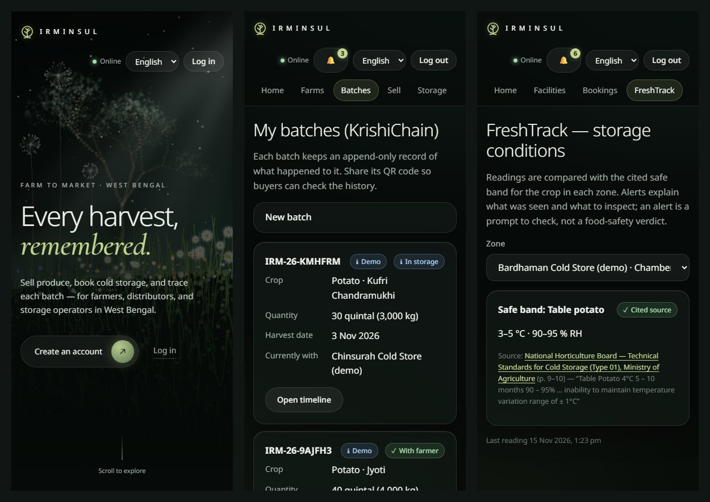

<p align="center">
  
</p>

<h1 align="center">Irminsul</h1>

<p align="center"><em>Every harvest, remembered.</em></p>

<p align="center">
  A farm-to-market platform for West Bengal: farmers sell produce and book cold storage,<br>
  and every batch carries a tamper-evident history that a buyer can check with a QR code.
</p>



## Why this exists

A lot goes wrong between a field in Hooghly and a market in Kolkata, and very little of it is written down. Prices come from word of mouth. Cold storage is booked by phone. When a chamber warms up overnight, nobody can say whether a lot of potatoes was affected. And a buyer has no way to check where produce came from or how it was kept.

Irminsul puts that journey into one shared record. A batch is created at harvest, and everything after that adds a line to its history: the listing, the sale, check-in to a cold store, the storage readings, a split, dispatch, delivery. Each line is hashed onto the one before it, so the history can't be quietly edited. A buyer scans the QR code and sees the whole thing.

## What it does

- **Marketplace:** farmers list batches; distributors make offers, counter and accept; orders move from confirmed to dispatched, delivered and closed.
- **Cold storage:** find stores that take your crop and have room, request a booking, check in, release. Capacity can never be overbooked.
- **KrishiChain traceability:** a hash-chained history for every batch, with corrections and splits, plus a public verification page that shows no personal data.
- **FreshTrack:** chamber readings are compared with safe bands cited from National Horticulture Board standards. Alerts explain what was seen, for how long, and what to inspect.
- **Farmer intelligence:**
  - weather forecasts with sourced advisories (Open-Meteo);
  - crop photo screening for potato and tomato (an ONNX MobileNetV2 model, "possible condition", never a diagnosis);
  - dated mandi prices, with the net you'd take home at each market after transport.
- **Emergency coordination:** a flood drill finds the lots at risk, ranks them by how quickly they spoil, and suggests the nearest store outside the area that has space.
- **Three languages:** English, বাংলা and हिन्दी throughout, and every page works at phone width.

## Screenshots

| | |
|---|---|
|  **Batch timeline**: an integrity check, a QR code, and every event fingerprinted |  **FreshTrack**: readings against the safe band, with an explained temperature alert |
|  **Market**: listings on a map, each with its harvest date and chain status |  **Flood drill**: exposed stores and lots, with relocation proposals |
|  **Mandi prices**: real AGMARKNET data, always shown with its date |  **Public verification**: no login, no names, the chain checked on every load |
|  **Landing page**: the batch record drawn as a 3D chain of sealed blocks |  **বাংলা**: the same app in Bengali |



All screenshots are in [`docs/screenshots/`](docs/screenshots). The [user guide](docs/user-guide.md) walks through each screen.

## Try it locally

You need [uv](https://docs.astral.sh/uv/) and a MongoDB Atlas cluster (the free tier is fine). Transactions need a replica set, so a standalone local MongoDB won't work.

```bash
git clone https://github.com/soham-newjourney2/Irminsul.git
cd Irminsul
bash scripts/setup.sh                      # Python 3.12, .venv, dependencies, a .env to fill in
# edit .env: MONGODB_URI, JWT_SECRET, SEED_DEMO_PASSWORD
uv run python -I scripts/seed.py           # demo accounts and data
uv run uvicorn backend.app.main:app --reload
```

Then open <http://127.0.0.1:8000>. Crop screening needs the model files, which aren't in git; see [development.md](docs/development.md#the-screening-model). Everything else works without them.

## Sample credentials

`scripts/seed.py` creates these accounts. They all share one password: **the value of `SEED_DEMO_PASSWORD` in your `.env`**. The seed never hard-codes or prints it. If you're looking at a hosted demo, its password is shared separately.

| Email | Role | Worth a look |
|---|---|---|
| `farmer@demo.irminsul.test` | Farmer (Gopal, Hooghly) | potato in cold storage; a listing with a countered offer |
| `farmer2@demo.irminsul.test` | Farmer (Rina, Nadia) | tomato in Chinsurah Chamber B |
| `farmer3@demo.irminsul.test` | Farmer (Sukumar, Purba Bardhaman) | a delivered rice order; potato in a chamber with a live alert |
| `farmer4@demo.irminsul.test` | Farmer (Anwara, Murshidabad) | jute listing with a pending offer; jute in a warehouse |
| `farmer5@demo.irminsul.test` | Farmer (Biswajit, Hooghly) | a tomato batch split in two; a booking awaiting approval |
| `distributor@demo.irminsul.test` | Distributor (Ria Traders) | delivered and confirmed orders |
| `distributor2@demo.irminsul.test` | Distributor (Bose Agro) | a countered offer and a pending one |
| `operator@demo.irminsul.test` | Cold-store operator (Chinsurah, Bardhaman) | a booking request; a temperature alert to acknowledge |
| `operator2@demo.irminsul.test` | Cold-store operator (Manikchak, Jiaganj) | two stores inside the Ganga flood drill |
| `admin@demo.irminsul.test` | Admin | approvals, demo controls, the running flood drill |

Everything these accounts show is fictional and marked as demo data in the UI.

## How it's built

A single FastAPI service serves both the JSON API and a plain HTML/CSS/JavaScript frontend. There's no build step and no framework; pages are ES modules. Data lives in MongoDB Atlas, the screening model runs on ONNX Runtime, and maps and charts use Leaflet and Chart.js. The look (dark glass, generated meadow and fern artwork, a canvas 3D world-tree and a CSS 3D chain) is all code, with no image assets.

The [architecture notes](docs/architecture.md) cover the modules, the hash chain, the FreshTrack rules, the emergency logic and the security model.

```
backend/app/     FastAPI app: core/, db/, integrations/, ai/, workers/, modules/<feature>/
backend/tests/   pytest suite
frontend/        HTML pages, css/, js/ (ui/, pages/), locales/ (en, bn, hi)
data/            storage rules, advisory rules, flood scenarios, the dated mandi snapshot
ai/              model card, checksum lock file, sourced crop guidance
scripts/         setup, seed, admin, demo/, data/, model/
docs/            user guide, architecture, development, deployment, data sources, screenshots
```

## Checks

```bash
uv run ruff check . && uv run ruff format --check . && uv run pyright
uv run pytest -q
```

The test suite has 171 tests and runs against a separate Atlas database that's dropped afterwards.

## What's real and what isn't

We've tried hard not to dress anything up:

- **Mandi prices** are real AGMARKNET data from a dated snapshot. The newest prices are from 20 April 2026, because the live data.gov.in API was down when this was built. The date appears next to every price.
- **Weather** is a live Open-Meteo forecast. Road distances come from the public OSRM server, falling back to a labelled estimate.
- **Storage readings** in the demo come from a simulator and are labelled "Simulated". The safe bands are quoted from the NHB standards. The alert timings (30 and 120 minutes) are our own assumptions, and the cards say so.
- **Flood areas** are drawn for demonstration. They are not forecasts or hazard maps.
- **Crop screening** was trained on lab photos and is unreliable on field photos. That's why it says "not sure" so often, and why it never claims to diagnose anything.
- **Translations:** the Bengali and Hindi text still needs review by a native speaker.

## Deploying

[docs/deploy.md](docs/deploy.md) covers deploying to Render's free plan with MongoDB Atlas. `render.yaml` holds the service definition, and no secrets are in the repo.

## Credits

- Map data © [OpenStreetMap](https://www.openstreetmap.org/copyright) contributors; geocoding by Nominatim.
- [Leaflet](https://leafletjs.com) and [Chart.js](https://www.chartjs.org).
- Weather data by [Open-Meteo.com](https://open-meteo.com) (CC BY 4.0); routing by [OSRM](https://project-osrm.org).
- Mandi prices: AGMARKNET, Ministry of Agriculture & Farmers Welfare, via data.gov.in (GODL-India). Compiled by Manas Khandelwal (Kaggle) and read from a Hugging Face mirror.
- Crop screening model: [`LourivalGontijo/plantvillage-mobilenetv2`](https://huggingface.co/LourivalGontijo/plantvillage-mobilenetv2) (Apache-2.0), trained on PlantVillage.
- Cold-storage standards: National Horticulture Board. Crop guidance: TNAU Agritech Portal.
- Fonts: Noto Sans (with Bengali and Devanagari) and Cormorant Garamond, under the SIL Open Font License.

Full source notes are in [docs/data-sources.md](docs/data-sources.md).

## Licence

[MIT](LICENSE)
