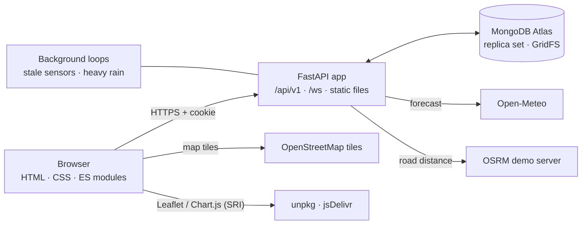

# Architecture

Irminsul is one FastAPI service that serves both the JSON API and the static frontend, backed by MongoDB Atlas. There's no build step for the frontend and no separate worker process: background jobs are asyncio tasks started with the app.



## Backend

```
backend/app/
  main.py            app factory, middleware, routers, lifespan (indexes + background tasks)
  config.py          settings from the environment (.env locally)
  core/              errors, envelopes, security, RBAC deps, audit, rate limits,
                     idempotency, units, geo, WebSocket hub, middleware
  db/                Mongo client, transactions, index definitions
  integrations/      Open-Meteo, OSRM (+ cached distances)
  ai/                ONNX screening model loader and inference
  workers/           background loops
  modules/<name>/    router.py · schemas.py · service.py per feature
```

| Module | What it owns |
|---|---|
| `auth`, `users`, `admin` | email login, sessions, profiles, approvals, audit log views |
| `farms` | farm plots with a location |
| `listings`, `procurement` | listings, offers and counter-offers, orders |
| `storage` | facilities, zones, bookings, the capacity rule |
| `batches` | KrishiChain: batch records, the hash chain, splits, QR tokens, the public view |
| `freshtrack` | readings, the alert engine, inspections, the simulator |
| `screening` | photo upload checks and the crop model |
| `weather`, `mandi` | forecasts and advisories; the price snapshot and net realisation |
| `emergency`, `aquasentinel` | flood drills, exposure, relocation; rainfall layer and alerts |
| `notifications` | in-app notifications, pushed over the WebSocket |

Routers only parse input and check permissions; services do the work. Every response uses the same envelope: `{"data": ..., "meta": ...}` on success and `{"error": {"code", "message", "details"}}` on failure.

## Data

Quantities are stored as whole kilograms and money as whole paise, so there's no floating-point rounding anywhere in trade or storage. The UI converts to quintals, tonnes and rupees for display.

Main collections: `users`, `organizations`, `farms`, `produce_listings`, `purchase_requests`, `orders`, `storage_facilities`, `storage_zones`, `storage_bookings`, `produce_batches`, `batch_events`, `batch_lineage`, `batch_qr_tokens`, `storage_observations`, `storage_alerts`, `inspection_records`, `emergency_events`, `relocation_plans`, `weather_alerts`, `price_observations`, `markets`, `notifications`, `audit_logs`. Indexes, including the 2dsphere ones used for maps and drills, are defined in `backend/app/db/indexes.py` and created on startup.

Anything that has to change several documents at once, such as accepting an offer, booking space or splitting a batch, runs in a MongoDB transaction. That's why Atlas (a replica set) is required rather than a standalone `mongod`.

## KrishiChain: the batch record

Each batch event stores `hash = sha256(prev_hash + canonical JSON of the event)`, with timestamps normalised to milliseconds so the hash is stable. Checking a batch means walking the events and recomputing every hash. The first mismatch shows where the record was altered.

- Most events are written automatically by the feature that caused them: listing, accepting an offer, checking in, dispatch, delivery, relocation.
- Corrections are new events that point at the one they correct. Nothing is overwritten.
- A split marks the parent as `split` and creates child batches, linked in `batch_lineage`.
- QR codes carry an opaque token, not the batch id. The public view shows crop, district, harvest date and the timeline, and never shows names, contact details or exact coordinates.

This is tamper-evidence inside one database, not a blockchain. It catches edits made outside the app, but not someone who controls the database and rewrites the whole chain.

## FreshTrack

Safe bands come from `data/storage_rules.json`. Each band quotes its source (National Horticulture Board cold-storage standards) and says whether it has been verified. The engine in `modules/freshtrack/engine.py` is made of pure functions:

- **Excursion:** outside the band for 30 minutes gives a warning, 120 minutes a critical alert.
- **Stale:** no reading for 30 minutes.
- **Implausible:** outside −10 to 50 °C or 5 to 100 % RH, or a jump of more than 8 °C within 10 minutes.
- **Unusual:** more than 3 standard deviations from the last 24 readings (information only).

The durations and limits are Irminsul's own assumptions, not standards, and every alert card says so.

## Emergency coordination

A drill loads a scenario polygon from `data/flood_scenarios/`. A `$geoWithin` query then finds the farms, facilities, stored lots and upcoming bookings inside it. Lots are ranked by perishability. For each lot, the candidate stores are those outside the area that accept the crop and have room, sorted by road distance from OSRM. If OSRM is down, the distance falls back to great-circle distance × 1.3 and is labelled an estimate. Confirming a move books space at the new store, adds a `relocated` event to the batch, and is audited.

## Security

- **Passwords and sessions:** Argon2 password hashes; a signed JWT in an httpOnly, `SameSite=Lax` cookie (Secure in production) with a 12-hour lifetime.
- **Permissions:** checked on the server for every route. Hiding a button in the UI is only cosmetic.
- **Security headers:**
  - Content Security Policy without `unsafe-inline`, so the frontend has no inline scripts, styles or event handlers;
  - `X-Frame-Options: DENY`, `nosniff` and `Referrer-Policy: same-origin`;
  - HSTS in production;
  - `no-store` on API responses.
- **Map tiles:** the only exception to the referrer policy. Tile requests send just the site origin, as OpenStreetMap's usage policy requires.
- **Limits:** request bodies are capped (256 KB, or 3 MB for photo uploads). Login is rate-limited per email and IP, and screening per user.
- **Duplicates and audit:** creates accept an `Idempotency-Key` so retries don't duplicate records. Admin and business-critical actions go to an append-only audit log.
- **Uploads:** checked for size, type, decodability and pixel count before they reach the model.

## Frontend

```
frontend/
  *.html, farmer/, distributor/, storage/, admin/   one HTML file per page
  css/   tokens.css · base.css · components.css · scene.css
  js/    api.js · auth.js · i18n.js · format.js
         ui/     shell, dom helpers, map, charts, notifications,
                 nature.js (generated meadow and fern artwork), tree3d.js (canvas 3D),
                 chain3d.js (CSS 3D), motion.js (reveal, tilt, counters)
         pages/  one module per page
  locales/  en.json · bn.json · hi.json
```

Pages are plain HTML with `data-i18n` keys. A page module mounts the shared shell (header, navigation, language, notifications) and renders with small DOM helpers. Text is always set with `textContent` and never with `innerHTML` from data. Leaflet and Chart.js load from CDNs with Subresource Integrity hashes. The artwork is generated as SVG in the browser, so there are no image assets to ship. The 3D world-tree is a hand-written perspective projection on a canvas. The tree pauses when it's off screen or the tab is hidden, and anyone with "reduce motion" switched on gets still frames.
