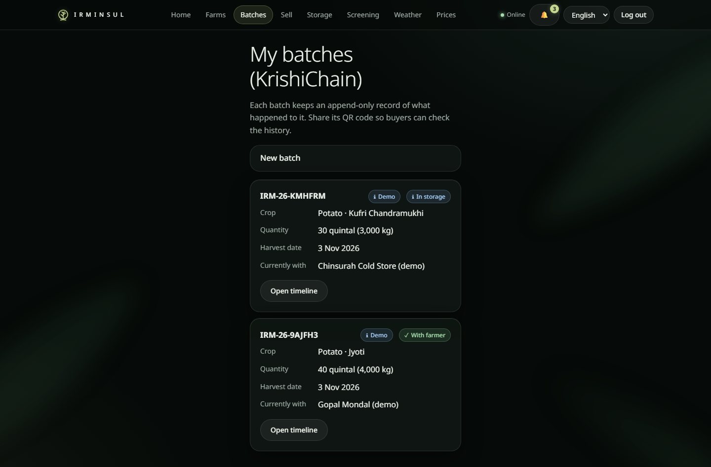
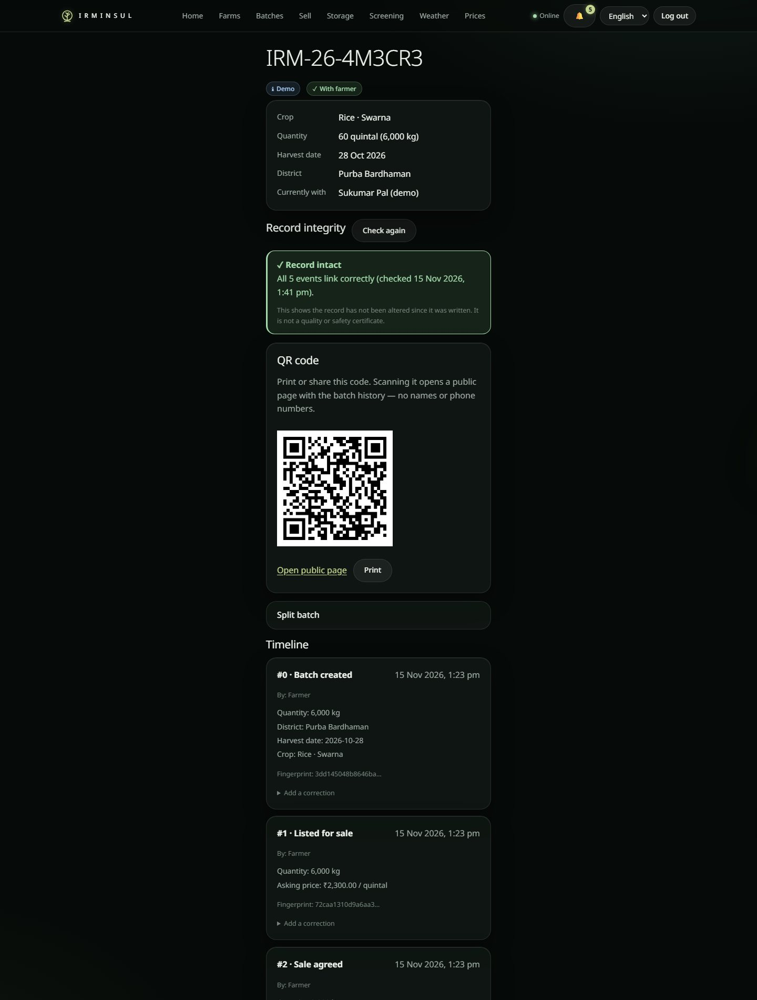
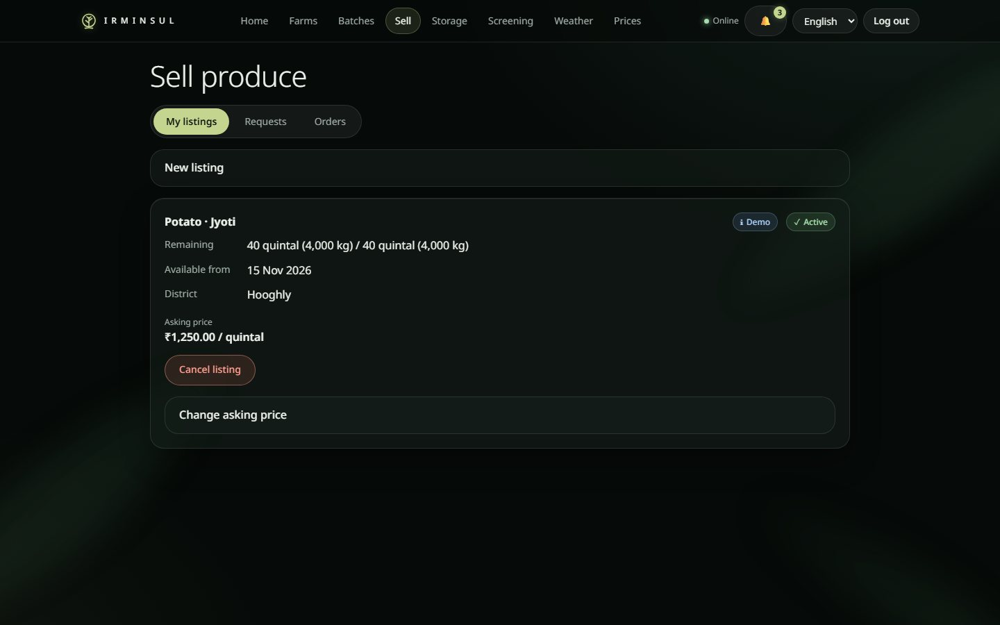
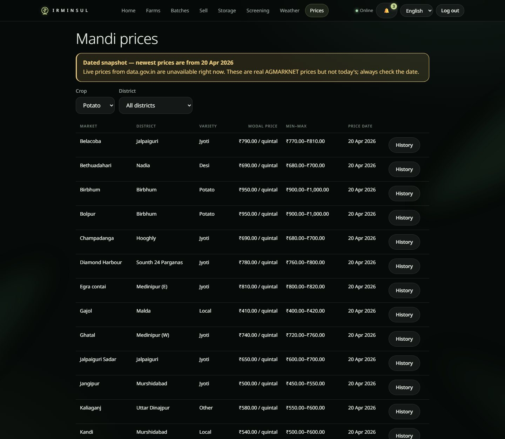
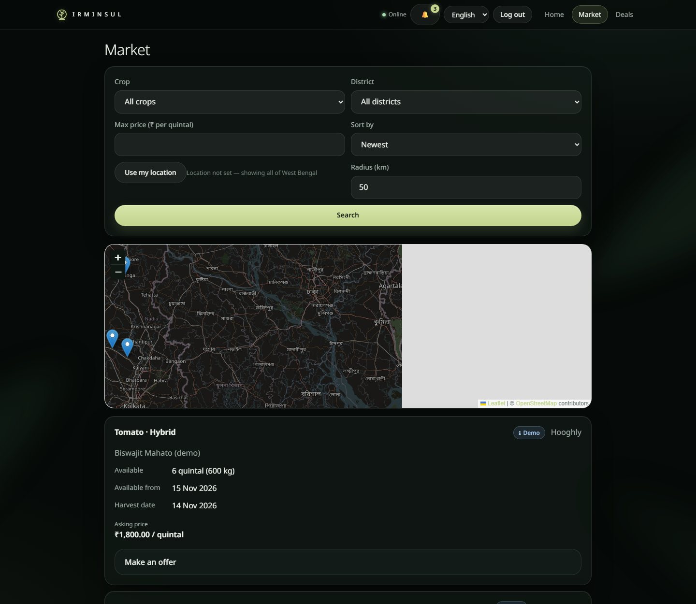
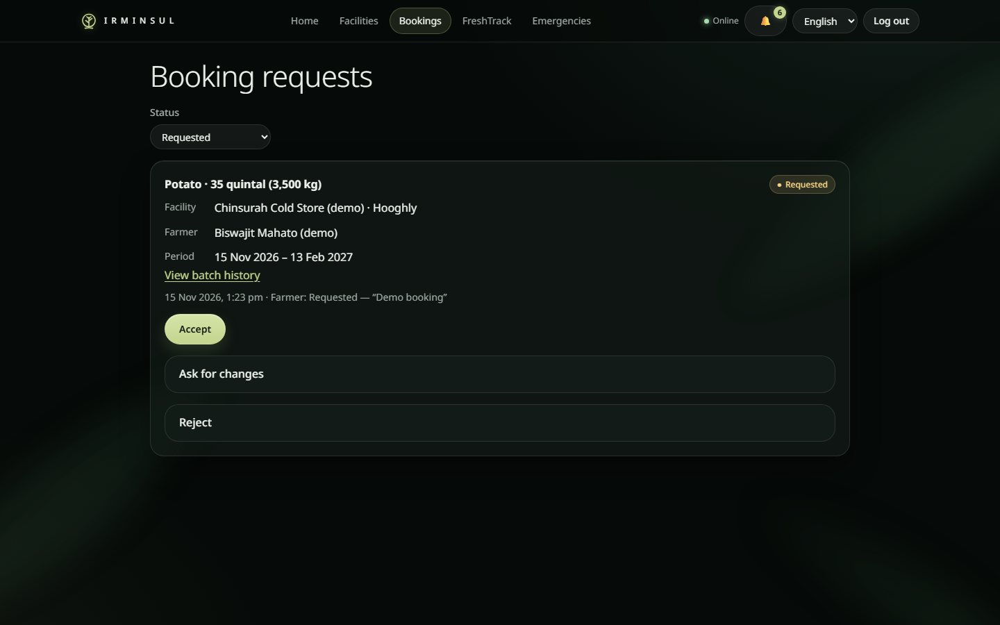
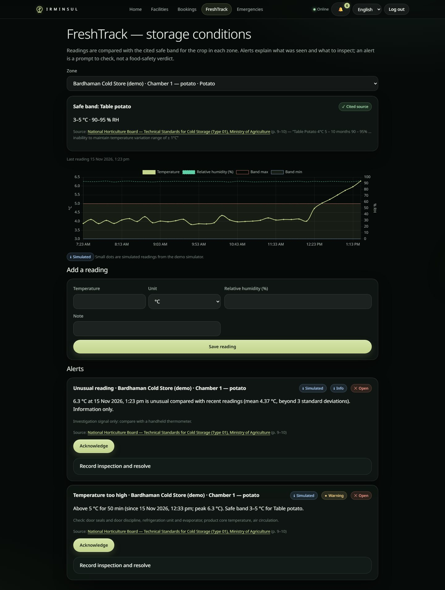
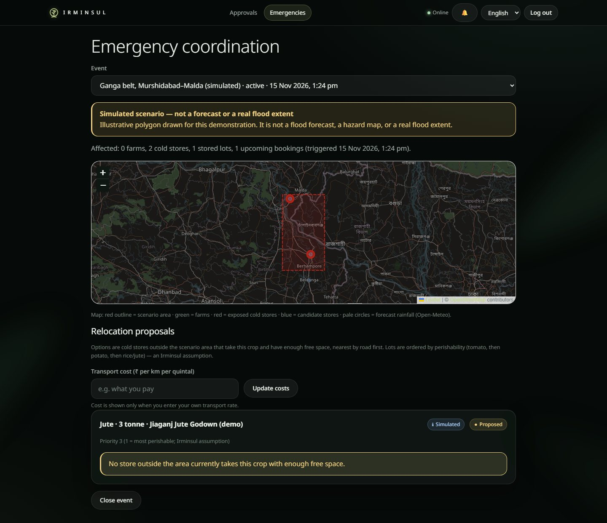
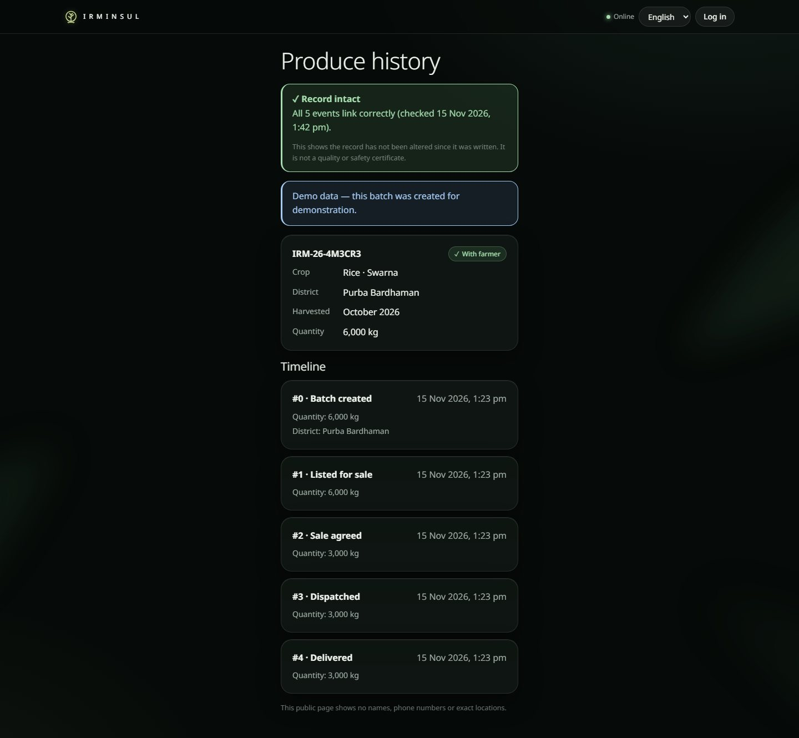
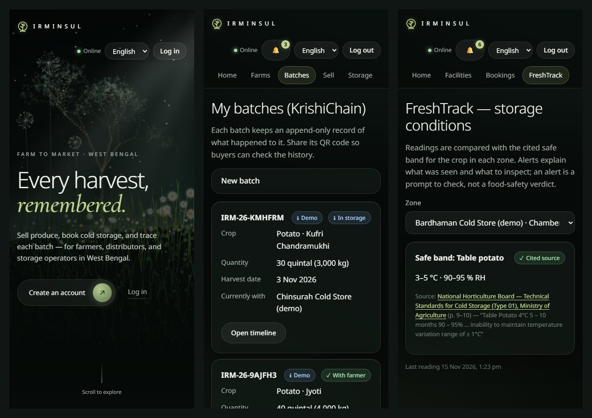

# User guide

Irminsul has four kinds of users and one public page. This guide walks through each of them using the demo data from `scripts/seed.py`, so every screen described here has something on it. Account emails are listed in the [README](../README.md#sample-credentials).

- [Farmers](#farmers)
- [Distributors](#distributors)
- [Cold-storage operators](#cold-storage-operators)
- [Admins](#admins)
- [Public batch verification](#public-batch-verification)
- [A ten-minute demo](#a-ten-minute-demo)

Every page works in English, Bengali and Hindi. The language switch is in the header, and logged-in users keep their choice across devices.

## Farmers

Farmers can sign up on their own and start straight away.

**Farms.** Add each plot with its district and a pin on the map. Weather advisories and distance-based prices use that location.

**Batches.** A batch is one harvest of one crop: say, 40 quintals of Jyoti potato picked on a given day. From the moment it's created, everything that happens to it (screening, listing, sale, storage, dispatch, a split) is written into its history. You can't edit that history. Mistakes are fixed by adding a correction, and the original stays visible.

Each batch has its own page with an integrity check, a QR code to share with buyers, and the full timeline. Every entry carries a fingerprint (hash) that links it to the entry before it.

**Selling.** List a batch with an asking price. Distributors send offers, and you can accept, reject or counter. Asking and agreed prices are always labelled differently, so nobody mistakes one for the other. Accepting an offer turns it into an order, and the quantity comes off the listing in the same step.

**Storage.** Search cold stores that take your crop and have room, then request a booking. Once your lot is checked in, you can see the chamber readings for it.

**Screening.** Upload a photo of a leaf to get a *possible* condition for potato or tomato, along with sourced guidance. It isn't a diagnosis. When the model isn't confident it says "not sure", which happens a lot with field photos.

**Weather.** A 7-day forecast for each farm (Open-Meteo), plus advisories when a rule is triggered, such as heavy rain near harvest. Each advisory shows its source and the assumptions behind it.

**Prices.** Mandi prices from a dated AGMARKNET snapshot. The date sits right on the page, because these are not today's prices. A net-realisation tool shows what you'd actually take home from each market after transport, using a transport rate you enter yourself.

## Distributors

Distributor accounts need an admin's approval before they can trade.

**Market.** Filter listings by crop, district, price or distance, and see them on the map. Every listing shows its harvest date and whether its batch history is intact.

**Deals.** Make an offer, answer counter-offers, and track orders: confirmed → dispatched (the farmer marks it) → delivered (you mark it) → closed. Each step is added to the batch's history.

## Cold-storage operators

Operator accounts also need approval.

**Facilities and zones.** A facility has a location, the crops it accepts and a capacity. Inside it, zones (chambers or godowns) each get a *rule profile*, such as table potato at 3–5 °C and 90–95 % RH, quoted from National Horticulture Board standards. Reserved and occupied space can never add up to more than the capacity. The server enforces that in a single transaction.

**Bookings.** Requests arrive from farmers. You accept or reject them, check lots into a zone, and release them when they leave. On release, a summary of the storage conditions is added to the batch's history.

**FreshTrack.** Staff type readings in, or the demo simulator writes them, and each zone's readings are compared with its safe band. Alerts explain themselves: what was seen, for how long, what the band is and where it comes from, and what to inspect. You acknowledge an alert, then resolve it with an inspection note. Simulated readings are always labelled.

## Admins

There's no sign-up for admins; they're created with `scripts/create_admin.py`.

**Approvals.** Approve or reject new distributors and operators. Every decision goes into the audit log.

**Demo controls.** Start or stop the sensor simulator, run the heavy-rain check, and trigger a flood drill. Everything these controls create is labelled as simulated.

**Emergencies.** A flood drill draws a scenario area on the map and works out what falls inside it: farms, cold stores, stored lots and upcoming bookings. Lots are ranked by how quickly they spoil (tomato, then potato, then rice and jute). For each lot, Irminsul suggests stores outside the area that take the crop and have room, nearest by road first. Confirming a move is audited. The areas are drawn for demonstration and are not flood forecasts.

## Public batch verification

Scanning a batch's QR code opens a public page with no login. It shows the crop, the district, the harvest date and the full timeline, and it checks the hash chain then and there. It never shows names, phone numbers, emails or exact coordinates.

## A ten-minute demo

With the seeded data:

1. Open the landing page and switch to বাংলা and back.
2. Log in as `farmer3@` and open the rice batch: five events, record intact, QR code.
3. Click **Open public page** on the QR card and show that the history checks out without logging in.
4. Log in as `distributor2@` and look at the countered offer on Gopal's potato.
5. Log in as `operator@` and open **FreshTrack** → Bardhaman Chamber 1. There's a temperature warning: above 5 °C for 50 minutes. Acknowledge it.
6. Log in as `admin@` and open **Emergencies**. The Ganga belt drill is running, and the jute lot has nowhere to go because no other store takes jute. Then trigger the Hooghly riverside drill from **Demo controls** and watch the tomato and potato lots at Chinsurah get relocation options.
7. Finish on a phone: every page works at phone width.

